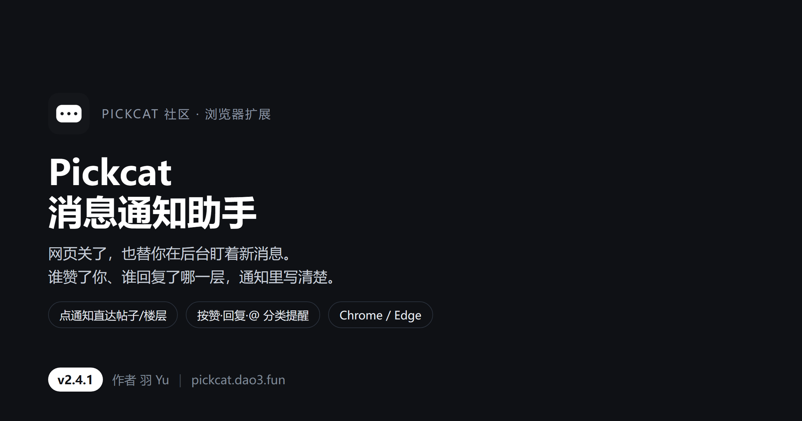

# pickcat-notify

Pickcat（pickcat.dao3.fun）社区消息通知助手 —— **网页关掉，也能收到谁赞了你；点通知直达帖子楼层**。

作者：羽Yu ｜ 版本：v2.4.1（测试版）｜ 更新：2026-11-12



---

## 它做什么

- 关掉 Pickcat 标签页后，后台仍按分钟检查未读消息
- 桌面通知写清三件事：**谁**、**做了什么**、**哪条内容**
- 按站点真实的 14 种通知类型分别写文案（`POST_LIKED` → 赞了你的内容、`REPLY_CREATED` → 回复了你的帖子 …）
- 点通知直达对应帖子 / 作品；回复、@ 还会落到具体楼层（`#post-<n>`）
- 弹窗按「回复 / @我 / 赞 / 关注·系统」分类查看，每条可点
- 提醒范围四类可分别开关，点赞默认合并成一行，不连弹
- 免打扰时段、未读角标、全部已读
- 跟随系统深色 / 浅色

## v2.4.1 更新要点

1. **修掉「浏览器自己弹出、自己打开 PICKCAT 页面」**：后台兜底里的开标签页 / 弹小窗已删除，新增「允许后台页面兜底」开关并默认关闭——读不到登录态就安静报错，绝不开页面
2. **修正通知文案**：旧版类型映射与站点真实类型对不上，大多只显示「有新动态」，现在逐条对应
3. **修好头像**：头像字段是 `{type,id,url}` 对象，旧代码直接转字符串得到 `[object Object]`
4. **点通知直达**：帖子 `/forum/post/<id>`、作品 `/works/<id>`，带楼层锚点
5. **消息提醒更细**：回复、@、赞、关注与系统四类分别开关 + 点赞合并
6. **Chromium 兼容层**：`browser` / `chrome` 双兜底，`manifest` 声明 `minimum_chrome_version: 88`
7. **界面重做**：弹窗 336px 分类浏览，设置项全部收进设置页，引导页重写

每一版改了什么、修了什么，见 [CHANGELOG.md](CHANGELOG.md)。

## 安装（只有 zip，没有 crx）

1. 到右侧 **Releases** 下载 v2.4.1 的 `pickcat-notify.zip` 并解压（仓库文件列表里也有同一个 zip）
2. 打开 `chrome://extensions/`（Edge 是 `edge://extensions/`），右上角开启「开发者模式」
3. 点「加载已解压的扩展程序」，选中解压出的 `pickcat-notify` 文件夹
4. 自动弹出引导页，登录 Pickcat 后点「立即检查」

> 源码目录也直接可用：把仓库里的 `pickcat-notify` 文件夹「加载已解压」即可。
> 升级时不用删除旧版，覆盖源码后在扩展页点「刷新」。

## 兼容性

| 浏览器 / 系统 | 状态 |
| --- | --- |
| Edge 157 · Windows 11 | 实测通过（加载、后台检查、通知、直达跳转） |
| Chrome 152 · Windows 11 | 实测通过（未打包扩展刷新后版本 2.4.1，定时任务运行中） |
| 其他 Chromium ≥ 88 | 理论可用，未逐个实测 |
| macOS / Linux 上的 Chrome、Edge、Chromium | 代码无 Windows 专有调用，**未实测** |
| 360 / QQ 等加壳浏览器 | 不保证，不适配 |
| 手机 / 平板（安卓、鸿蒙） | 不支持，移动浏览器装不了桌面扩展 |

## 权限与边界

| 权限 | 用途 |
| --- | --- |
| `alarms` | 定时检查未读 |
| `notifications` | 弹新消息提醒 |
| `storage` | 存设置与上次读数（本地） |
| `pickcat.dao3.fun` | 读未读数与通知列表 |

- 只访问 `pickcat.dao3.fun`，只发 GET，不保存密码；不发帖、不评论、不点赞
- **唯一例外**：手动点「全部已读」时发一次 `PATCH /api/v1/notifications`（`{"read":true}`）
- 不申请 `tabs`（读取浏览记录）权限
- **不会自己开网页**：默认只发直连请求，读不到就在设置页写清原因（未登录 / 网络不通 / 被限流），不会弹窗口、不会自己冒出 PICKCAT 页面。想做后台页面兜底，得自己在设置里打开那个开关
- 关标签页：**能收到**；关窗口但进程还在：**能**；完全退出浏览器 / 关机：**不能**
- 检查最快 1 分钟一次；免打扰时段不弹通知但角标照常

## 目录

```
pickcat-notify/        扩展源码（要加载的就是这个文件夹）
宣传图/                介绍用图（封面、通知示意、界面截图）
CHANGELOG.md           每一版改了什么、修了什么
pickcat-notify.zip     打包好的安装包（下载解压即用）
```

## 声明

这个插件是**我想出来、我需要的**：需求、功能取舍、界面和文案反复改的方向，都来自我自己。

代码、图标、宣传图、文档文字，是在 **AI（豆包）协助下**一起做出来的——我提要求、看结果、挑毛病，AI 负责动手实现。所以它不是「一个人从零手写」的作品，也不隐瞒这一点。

以**非商业测试版**发布，免费给 PICKCAT 社区的朋友使用。
