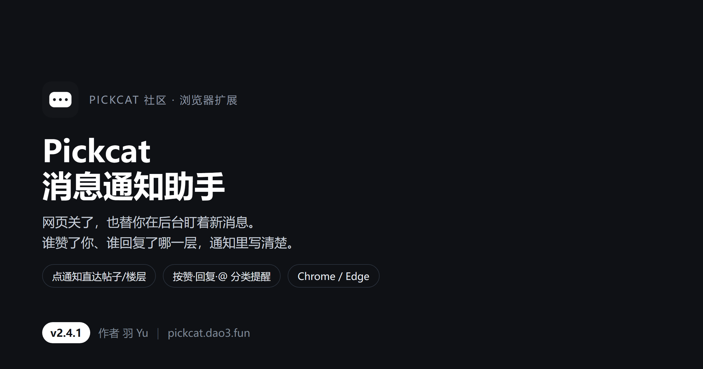
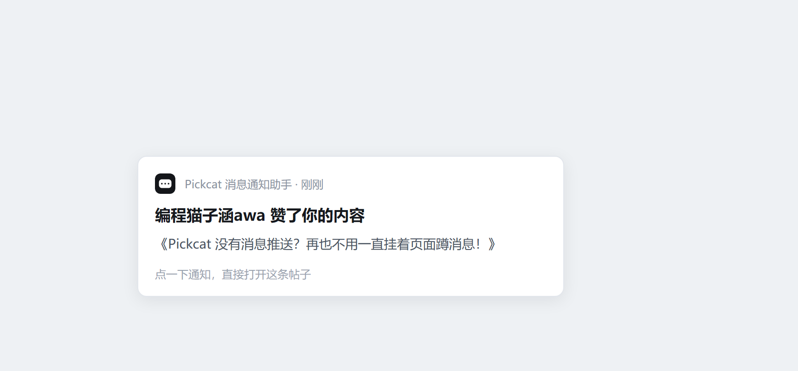
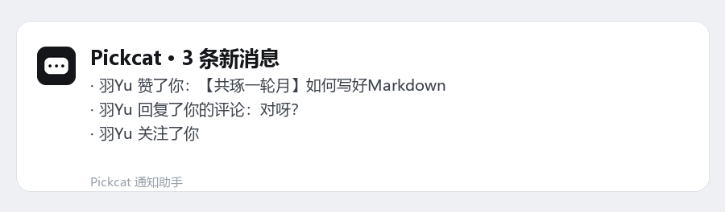
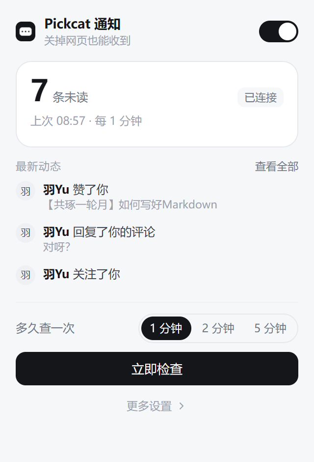
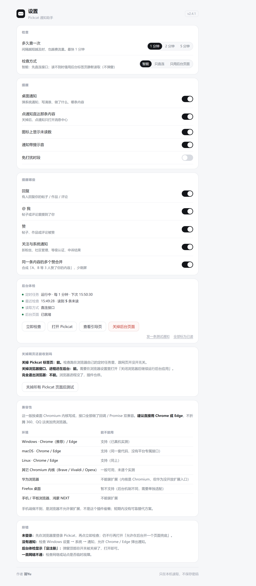
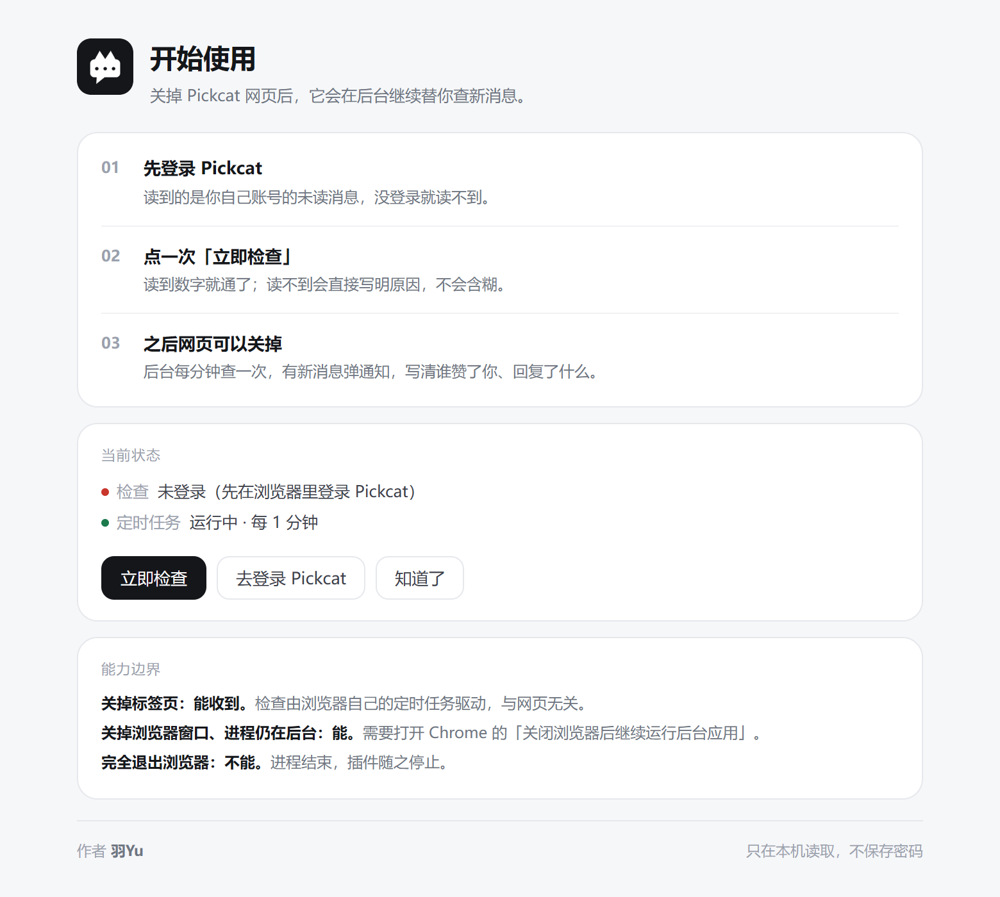

# PICKCAT 消息通知助手 · 宣传文档

> 版本 2.4.0 ｜ 作者：羽Yu ｜ 适配站点：https://pickcat.dao3.fun ｜ 更新日期：2026-11-12

---

## 一、这是什么

一个装在 Chrome / Edge 里的浏览器扩展，专门服务 **PICKCAT 社区**。

它只做一件事：**你的 Pickcat 网页关掉了，它还在后台替你盯着未读消息；一有新动静就在系统通知里告诉你，谁、做了什么、在哪条帖子或作品的哪一层。**

v2.4.0 这次把三件旧毛病一起修了：通知文案对不上站点真实类型、点头像全变成 `[object Object]`、点通知只能回首页。

---

## 二、v2.4.0 修了什么

| 项目 | 旧版（v2.3.1-beta） | 现在（v2.4.0） |
| --- | --- | --- |
| 通知文案 | 类型映射和站点真实通知类型完全对不上，大多只显示「有新动态」 | 按 `/api/v1/notification-summary` 的 14 种真实类型逐条翻译 |
| 头像 | 头像字段是对象，旧代码直接转字符串，全坏成 `[object Object]` | 正确取 `details.actor.avatar.url`，通知和弹窗都显示头像 |
| 点通知 | 打开站点首页，自己再找 | 直达对应帖子 / 作品，回复还能定位到具体楼层 |
| 消息提醒 | 只有开关，不分类型 | 回复、@我、赞、关注与系统通知四类可分别开关，点赞还能合并 |
| 浏览器兼容 | 只按 `chrome.*` 写，Edge 某些接口为空会报错 | 兼容层 `browser`/`chrome` 双兜底，Chrome / Edge 都实测通过 |
| 界面 | 弹窗里堆设置项，红点没分类 | 弹窗改成 336px 分类浏览，设置全部收进设置页 |

---

## 三、通知文案对照（真实类型，不是猜的）

站点的未读类型全集来自接口返回的 `unreadCountByType`，扩展按它逐条翻译：

| 站点真实类型 | 通知里怎么写 |
| --- | --- |
| `POST_LIKED` | 赞了你的内容 |
| `WORK_LIKED` | 赞了你的作品 |
| `WORK_COMMENT_LIKED` | 赞了你的作品评论 |
| `USER_FOLLOWED` | 关注了你 |
| `REPLY_CREATED` | 回复了你的帖子 |
| `WORK_COMMENT_CREATED` | 评论了你的作品 |
| `WORK_COMMENT_REPLY_CREATED` | 回复了你的作品评论 |
| `USER_MENTIONED` | 在帖子里 @了你 |
| `WORK_COMMENT_MENTIONED` | 在作品评论里 @了你 |
| `TOPIC_EVENT` | 你关注的帖子有新动态 |
| `LEVEL_CERTIFICATION` | 等级认证有结果了 |
| `MANAGEMENT_ACTION` | 社区管理操作（按 14 种动作细分文案） |
| `TAKEDOWN_APPEAL_DECIDED` | 下架申诉有结果了 |
| `QUESTION_DUPLICATE_REQUEST_DECIDED` | 重复提问申请有结果了 |

---

## 四、通知长什么样

**只有一条新消息时**，标题就是动作，正文是内容：

**多条新消息时**，标题给总数，正文按条列出（谁、做了什么、在哪条内容上）：

文案举例（都是真机跑出来的真实用户名）：

- `Helen.S 赞了你的作品：像素小台灯`
- `编程猫子涵awa、小小方a 赞了你的内容：Pickcat 没有消息推送？…`
- `一个黄脸 回复了你的帖子：应该有人发现这几个标签吧`

点赞默认合并：同一条内容被几个人赞，合成一行，不会连弹五条。

---

## 五、点一下通知会去哪

规则和站点前端自己的跳转函数一致：

| 通知类型 | 点开落到 |
| --- | --- |
| 作品相关（赞作品、评论作品） | `/works/<作品ID>`，若是评论还带 `#post-<楼层号>` |
| 帖子相关（回复、@、赞帖子） | `/forum/post/<帖子ID>`，楼层大于 1 时带 `#post-<楼层号>` |

已经开着同一个地址的标签页时，直接切过去，不再重复开新页。

---

## 六、界面

**弹窗**——336px，顶部未读总数与连接状态，分类切换（回复 / @我 / 赞 / 关注·系统），每条一行带箭头，点行即跳转，底部「全部已读」和免打扰提示。

**设置页**——提醒范围四个开关 + 合并点赞、免打扰时段、检查间隔与方式、后台体检、兼容性说明、全部标为已读。

**引导页**——装完只弹一次，四步走完就关。

**深色模式**——跟随系统，Windows 开深色主题就自动深色，不手动选。

---

## 七、兼容性（实测范围写清楚）

| 浏览器 / 系统 | 状态 |
| --- | --- |
| Microsoft Edge 157（Windows 11） | **实测通过**：加载扩展、后台定时检查、通知、直达跳转均正常 |
| Google Chrome 152（Windows 11） | **实测通过**：未打包扩展刷新后版本 2.4.0，后台体检显示定时任务运行中 |
| 其他 Chromium 内核浏览器（≥ 88） | 理论上可用（`manifest` 已声明 `minimum_chrome_version: 88`），未逐个实测 |
| macOS / Linux 上的 Chrome、Edge、Chromium | 代码层面无 Windows 专有调用，按 Chromium 扩展规范编写，**未实测** |
| 360 / QQ 等加壳浏览器 | **不保证**，也不打算适配 |
| 手机、平板（安卓 / 鸿蒙） | **不行**：移动浏览器不支持桌面扩展，站点也没做移动端推送 |

扩展依赖的是 `alarms`、`notifications`、`storage` 三个能力，这三项在所有 Chromium 系浏览器里行为一致，差异主要在系统通知外观。

---

## 八、权限与隐私：它到底能碰什么

| 权限 | 用途 | 边界 |
| --- | --- | --- |
| `storage` | 存设置、上次读数、最近通知对应地址 | 只在本地，不上传 |
| `notifications` | 弹新消息提醒 | 只弹自己创建的通知 |
| `alarms` | 每分钟定时检查 | 系统级定时，不常驻轮询 |
| `pickcat.dao3.fun` 站点权限 | 读未读数和通知列表、必要时开一个后台标签页 | **只限这一个域名** |

- **不申请**「读取浏览记录」（`tabs` 权限），已实测去掉后功能不受影响
- **不保存**账号密码，登录状态用的就是浏览器自己的 Cookie
- **只发 GET**：不发帖、不评论、不点赞、不改任何内容

> 唯一的例外，也如实写在这里：你在设置页或弹窗里**手动点「全部已读」**时，扩展会向站点发一次 `PATCH /api/v1/notifications`（`{"read":true}`），把消息标成已读。不点就不会发。

---

## 九、安装（三步，只有 zip 没有 crx）

1. 下载 `pickcat-notify.zip` 并解压
2. 打开 `chrome://extensions/`（Edge 是 `edge://extensions/`），右上角打开**开发者模式**，点「加载已解压的扩展程序」，选中解压出来的 `pickcat-notify` 文件夹
3. 自动弹出引导页，点「去登录 Pickcat」，登录后回来点「立即检查」

看到未读数就通了。

---

## 十、能力边界（如实说明）

| 情况 | 能不能收到 |
| --- | --- |
| 关掉 Pickcat 标签页 | **能** |
| 关掉浏览器窗口、进程还在后台 | **能**（需开 Chrome 的「关闭浏览器后继续运行后台应用」） |
| 完全退出浏览器 / 关机 | **不能**（浏览器进程没了，插件随之停止） |
| 处于免打扰时段 | 不弹通知，但角标数字照常更新 |

检查最快 1 分钟一次；系统睡眠期间不检查，唤醒后恢复。

---

## 十一、常见问题

**会不会被判定为刷接口？**
每分钟 1 次，和一个挂着消息中心的网页差不多；只读未读数与通知列表，不批量拉取。

**需要一直开着网页吗？**
不需要。这正是它存在的理由。

**为什么第一次装完有测试通知？**
确认通知通道通了。只发一次，之后只在真消息时提醒。

**升级要把旧的删掉吗？**
不用删。覆盖源码后到扩展页点「刷新」即可，设置和已读记录会保留。

**换电脑还要重新装吗？**
要。这是本地扩展，未上架商店。

---

## 十二、发布建议（发布由我自己操作）

**发帖标题**（挑一个）
- 给 PICKCAT 做了个消息通知插件：网页关了也能收到谁赞了你
- 写作业时老是漏评论？这个扩展替你在后台盯消息（v2.4.0）
- 自用插件分享：Pickcat 未读消息桌面通知，点通知直达楼层

**正文顺序**
1. 封面图
2. 一句话说明它解决什么
3. 两张通知示意图（比文字有说服力）
4. 弹窗 + 设置页截图
5. 安装三步 + 说清只有 zip、要开开发者模式
6. 权限和隐私一段，把「只发 GET、唯一 PATCH 例外」写明
7. 兼容性一张表，明说手机不行、加壳浏览器不保证
8. 明说边界：完全退出浏览器就收不到

**几个容易踩的坑**
- 别写「神器」「颠覆」，社区对夸张文案很敏感
- 一定写清「未上架商店、需要加载已解压」，否则会有人找不到安装入口
- 附上版本号和更新时间
- 有人问「能不能收私信 / 自动回复」，如实答：只读未读数与通知列表

---

## 声明

这个插件是**我想出来、我需要的**：需求、功能取舍、界面和文案反复改的方向，都来自我自己。

代码、图标、宣传图、文档文字，是在 **AI（豆包）协助下**一起做出来的——我提要求、看结果、挑毛病，AI 负责动手实现。所以它不是「我一个人从零手写」的作品，也不隐瞒这一点。

项目以**非商业测试版**发布，免费给 PICKCAT 社区的朋友用（v2.4.0）。

作者：**羽Yu**
